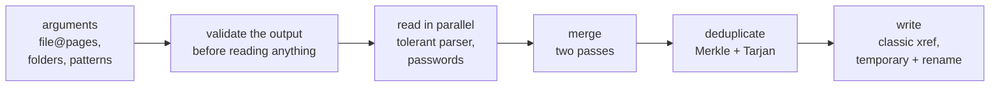
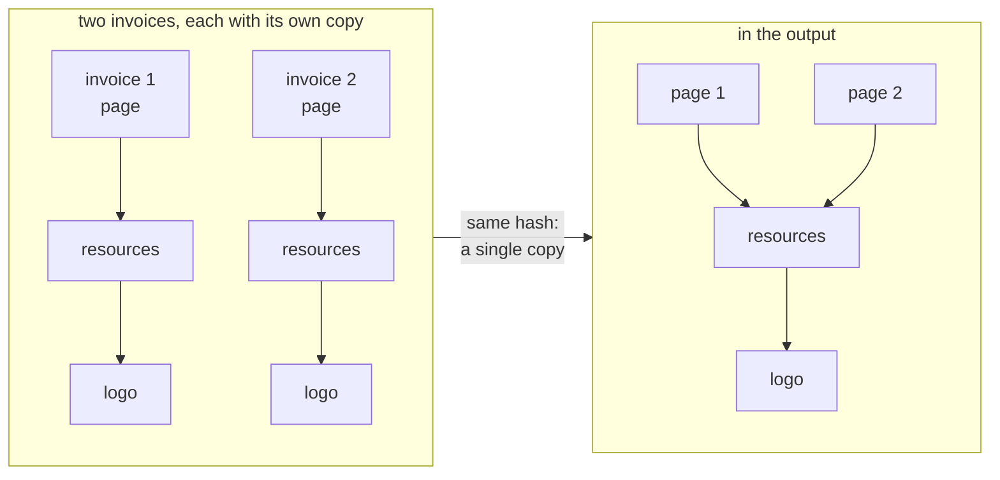

<p align="right"><sub><b>English</b> · <a href="README.md">Español</a></sub></p>

# pdf-merge

<p>
  <a href="https://github.com/agustinyarrus/pdf-merge/releases/latest"></a>
  
  
  
  <a href="LICENSE"></a>
</p>

Merge several PDFs into one from the Windows console, in the order you say and with the pages you pick, without uploading them anywhere. pdf-merge copies the pages as they are, keeps bookmarks, links and forms, opens encrypted PDFs and stores just once whatever repeats across files.

<p align="center">
  <picture>
    <source media="(prefers-reduced-motion: reduce)" srcset="demo/demo.png">
    
  </picture>
</p>
<p align="center"><sub>A real session in a 100×30 terminal, recorded with <a href="https://github.com/charmbracelet/vhs">VHS</a> on test PDFs: 44 MB in 49 ms · <a href="demo/demo.webm">as video</a> · <a href="demo/demo.tape">the script</a> · <a href="demo/LEEME.en.md">how to re-record it</a></sub></p>

<details>
<summary>No images? The same session, as text</summary>

```text
> pdf-merge informe.pdf@1-4 escaneo.pdf@impares facturas -o legajo.pdf

  pdf-merge  ·  combina varios PDF en uno, local                                            v1.0.0


  ● 6 archivos   ● salida legajo.pdf

  ✓ informe.pdf@1-4   4 de 12 páginas · 10,6 KB
  ✓ facturas\factura-01.pdf   1 página · 187 KB
  ✓ facturas\factura-02.pdf   1 página · 187 KB
  ✓ facturas\factura-03.pdf   1 página · 187 KB
  ✓ facturas\factura-04.pdf   1 página · 187 KB
  ✓ escaneo.pdf@impares   8 de 16 páginas · 43,1 MB


     pdf-merge

     ● Archivos               6
     ● Páginas                16
     ● Entrada                43,8 MB
     ● Salida                 21,7 MB
     ● Repetidos fusionados   16 objetos · −554 KB
     ● Marcadores             8
     ● Archivo                legajo.pdf
     ● Tiempo                 49 ms
```

</details>

A single `.exe` of about 3 MB, in pure Go and with its own PDF reader and writer: no installer, no dependencies, no cloud; the documents never leave the machine. It used to live in navaja, a suite of console tools for Windows; now it's a project of its own.

[Why](#why) · [Install](#install) · [Usage](#usage) · [Walkthrough](#walkthrough) · [How it works](#how-it-works) · [How it was verified](#how-it-was-verified) · [Limits](#limits)

## Why

Merging PDFs is one of the tasks most often solved by uploading documents to a "merge PDF" site: contracts, invoices, scans, exactly what you shouldn't send to someone else's server. Doing it on the PC has its twists, and pdf-merge solves them one by one:

- **Real PDFs aren't the ones in the manual.** Cross-reference streams, object streams, incremental updates, garbage before the header, offsets that don't point where they say. A strict reader rejects half of what comes out of an invoicing system.
- **Copying isn't redoing.** Pages are copied as they are, without recompressing or rasterizing: the quality is the original's.
- **Repetition weighs.** Ten invoices from the same system carry the same logo and the same fonts ten times. pdf-merge recognizes them by content and keeps a single copy.
- **Names clash.** Two documents can have a link destination or a form field with the same name; merged carelessly, a link jumps to the wrong file or two fields share a value.
- **"Protected" doesn't always mean a password.** Many PDFs are encrypted only to restrict printing or copying and open without one; the ones that ask for it get it with `--password`.

## Install

Download `pdf-merge.exe` from the [latest release](https://github.com/agustinyarrus/pdf-merge/releases/latest) and copy it to a folder on your `PATH`. It's the whole program: 64-bit Windows 10 or 11 (it was tested on Windows 11), no installer. Next to it comes `SHA256SUMS` to check it:

```powershell
(Get-FileHash .\pdf-merge.exe -Algorithm SHA256).Hash -eq ((Get-Content .\SHA256SUMS) -split '\s+')[0]   # True
```

The `.exe` is reproducible: the same tag built with the same Go gives the same bytes on any machine ([how](docs/RELEASE.en.md#5-the-exe-is-reproducible)).

With [Go](https://go.dev/dl) 1.26 or newer (with an older Go 1.21+, Go downloads the version the `go.mod` asks for on its own):

```powershell
go install github.com/agustinyarrus/pdf-merge@latest
```

From the repo:

```powershell
.\build.ps1          # dist\pdf-merge.exe, with the version, the commit and the SHA256
.\build.ps1 -Test    # before that, go vet and all the tests
```

It has no external modules: the reader, the writer, the encryption and the deduplication are Go's standard library and our own code.

## Usage

```powershell
pdf-merge a.pdf b.pdf c.pdf -o todo.pdf               # in that order
pdf-merge contrato.pdf@1-2 firmas.pdf -o firmado.pdf  # the first two pages of the contract and the signatures
pdf-merge libro.pdf@impares -o impares.pdf            # also: pares, reverso, 8- (to the end)
pdf-merge escaneos\ -o legajo.pdf                     # a whole folder, in natural order
pdf-merge protegido.pdf anexo.pdf --password clave    # a PDF that asks for a password
```

The selection goes right after each file, after an `@`: `1-3,5`, `8-`, `impares` (odd), `pares` (even), `reverso` (reverse). A file named `factura@2026.pdf` is taken whole, not as a selection.

The PDF comes out in the order of the arguments (what's in a folder or a pattern, in natural order). Files are read in parallel and each one is ticked off when it finishes, so the console list can come out in a different order: in the demo, the 43 MB scan ends up last.

| Flag | What it does |
|---|---|
| `-o`, `--out FILE` | the output PDF (`merged.pdf`) |
| `-f`, `--force` | overwrite the output if it already exists |
| `--no-dedupe` | don't merge repeated images and fonts across files |
| `-b`, `--bookmarks auto\|files\|keep\|none` | bookmarks: one per file with the originals inside (auto), only per file, only the originals or none |
| `-r`, `--recursive` | go into subfolders |
| `--skip-errors` | carry on without the PDFs that can't be read (by default, nothing is merged) |
| `-p`, `--password PASSWORD` | a password for encrypted PDFs; it can be repeated, and each one is tried on every file |
| `-j`, `--jobs N` | parallel reads (0 = one per CPU) |

GNU-style flags (`-o x`, `--out=x`, `-rf`, `--`); a misspelled flag suggests the closest one. Patterns (`*`, `?`, `[]`, `**`) are expanded by pdf-merge, because neither cmd nor PowerShell do it for a native program. It honors `NO_COLOR` and `--no-color`; if the output isn't a console, it doesn't emit a single escape code. Exit codes: `0` all good · `1` merged skipping unreadable PDFs (`--skip-errors`) · `2` invalid command line · `3` it couldn't merge · `130` canceled with Ctrl+C.

<details>
<summary><code>pdf-merge --help</code>, in full</summary>

```text
> pdf-merge --help

  pdf-merge  ·  combina varios PDF en uno, local                                            v1.0.0

  uso
    pdf-merge <archivo.pdf[@páginas]|carpeta|patrón>… [-o salida.pdf]
    pdf-merge a.pdf b.pdf c.pdf -o todo.pdf
    pdf-merge informe.pdf@1-3 anexo.pdf@5,8- -o recorte.pdf

  salida
    -o, --out ARCHIVO                PDF de salida (merged.pdf)
    -f, --force                      sobrescribir la salida si ya existe
        --no-dedupe                  no fusionar imágenes y fuentes repetidas entre archivos
    -b, --bookmarks auto|files|keep|none
                                     marcadores: uno por archivo con los originales adentro
                                     (auto), solo por archivo (files), solo los originales (keep)
                                     o ninguno (none) (auto)

  entrada
    -r, --recursive                  entrar en subcarpetas al pasar una carpeta
        --skip-errors                seguir sin los PDF que no se puedan leer (por defecto se
                                     aborta)
    -p, --password CLAVE             contraseña para abrir PDF cifrados (repetible; se prueba en
                                     cada uno)
    -j, --jobs N                     lecturas en paralelo (0 = una por CPU) (0)

  general
    -h, --help                       muestra esta ayuda
    -V, --version                    muestra la versión
        --no-color                   salida sin colores (también respeta NO_COLOR)

  ejemplos
    pdf-merge *.pdf -o todo.pdf                  todos los PDF de la carpeta, en orden natural
    pdf-merge contrato.pdf@1-2 firmas.pdf        las dos primeras del contrato y después las
                                                 firmas
    pdf-merge libro.pdf@impares -o impares.pdf   también: pares, reverso, 8- (hasta el final)
    pdf-merge escaneos/ -o legajo.pdf            una carpeta entera (orden natural: pag2 antes que
                                                 pag10)

  notas
    · Las páginas se copian tal cual: no se recomprime ni se pierde calidad.
    · Las imágenes y fuentes idénticas se guardan una sola vez aunque vengan de archivos distintos
      (típico al juntar facturas o catálogos del mismo sistema).
    · Los enlaces internos se conservan cuando apuntan a páginas incluidas.
    · Los PDF cifrados que se abren sin contraseña (solo restricciones) se combinan directo; los
      que piden una, con --password. La salida no va cifrada.
    · Si un nombre de archivo tiene '@' (factura@2026.pdf) se toma entero, no como selección.
```

</details>

## Walkthrough

Every output in this section is real: pdf-merge 1.0.0 in a 100-column console, on the demo's test PDFs in a folder mounted as `X:\docs\obra`, captured on Sep 28, 2026 (the tool speaks Spanish).

### A PDF that asks for a password

`contrato.pdf` is encrypted with AES-256 (revision 6), with a password to open it and restrictions on printing, copying and editing. With `-p` it opens and gets merged: its line says it was decrypted, and the footer's warning, that the restrictions don't carry over to the output (which isn't encrypted):

```text
> pdf-merge contrato.pdf informe.pdf@5- -o completo.pdf -p obra2026

  pdf-merge  ·  combina varios PDF en uno, local                                            v1.0.0


  ● 2 archivos   ● salida completo.pdf

  ✓ informe.pdf@5-   8 de 12 páginas · 10,6 KB
  ✓ contrato.pdf   12 páginas · 12,0 KB · descifrado


     pdf-merge

     ● Archivos               2                   ● Repetidos fusionados   3 objetos
     ● Páginas                20                  ● Marcadores             8
     ● Entrada                22,6 KB             ● Archivo                completo.pdf
     ● Salida                 16,5 KB             ● Tiempo                 5 ms

    ! 1 archivo tenía restricciones del propietario (imprimir, copiar, editar); la salida no las
      conserva
```

Without the password, nothing gets merged and it says why:

```text
> pdf-merge contrato.pdf informe.pdf -o x.pdf

  pdf-merge  ·  combina varios PDF en uno, local                                            v1.0.0


  ● 2 archivos   ● salida x.pdf

  ✓ informe.pdf   12 páginas · 10,6 KB
  ✗ contrato.pdf   pide contraseña para abrirse: pasala con --password

    ✗ No se combinó nada   1 archivo con error (usá --skip-errors para seguir sin ellos)
```

### One that can't be read

`roto.pdf` is the first 1,000 bytes of an invoice. By default, an unreadable PDF stops everything; with `--skip-errors`, the rest is merged and the exit code is `1`, so a script can notice:

```text
> pdf-merge informe.pdf roto.pdf -o todo.pdf

  pdf-merge  ·  combina varios PDF en uno, local                                            v1.0.0


  ● 2 archivos   ● salida todo.pdf

  ✓ informe.pdf   12 páginas · 10,6 KB
  ✗ roto.pdf   no encontré el catálogo del documento (/Type /Catalog)

    ✗ No se combinó nada   1 archivo con error (usá --skip-errors para seguir sin ellos)
```

```text
> pdf-merge informe.pdf roto.pdf -o todo.pdf --skip-errors

  pdf-merge  ·  combina varios PDF en uno, local                                            v1.0.0


  ● 2 archivos   ● salida todo.pdf

  ✓ informe.pdf   12 páginas · 10,6 KB
  ✗ roto.pdf   no encontré el catálogo del documento (/Type /Catalog)


     pdf-merge

     ● Archivos     1              ● Salida       10,0 KB        ● Tiempo       2 ms
     ● Páginas      12             ● Marcadores   4              ● Omitidos     1
     ● Entrada      10,6 KB        ● Archivo      todo.pdf
```

### It never overwrites an input

The output is validated before reading anything: it can't be one of the inputs, nor a file that already exists (without `--force`).

```text
> pdf-merge informe.pdf escaneo.pdf -o informe.pdf

  pdf-merge  ·  combina varios PDF en uno, local                                            v1.0.0


  ✗ la salida informe.pdf es también una de las entradas: elegí otro nombre con -o
```

### A misspelled flag

```text
> pdf-merge informe.pdf --bookmark none

  ✗ no conozco --bookmark; ¿quisiste decir --bookmarks?
  › pdf-merge --help muestra todas las opciones
```

## How it works



### Reading

- **A recursive-descent lexer** over the file in memory. Real numbers are rewritten with the shortest representation that round-trips to exactly the same float64 (rounding to 6 decimals shrank Chrome's bold, see below).
- **The cross-references**: classic tables (read by tokens: 19- or 21-byte rows are tolerated), xref streams with `/W`, `/Index` and PNG/TIFF predictors, object streams, the `/Prev` chain from newest to oldest and hybrid xrefs with `/XRefStm`.
- **Recovery**: if the table fails, it's rebuilt by sweeping the file for `N G obj`; if an object isn't where the table says, the rebuild is done once, on the fly. The trailer is looked for in the last `trailer`, in the most recent xref stream or, by hand, through the catalog.
- **Encryption**, before anything else (if the catalog is in an encrypted object stream, without the key it can't even be found): 40- and 128-bit RC4, AES-128 and AES-256, revisions 2 to 6 of the standard handler, with ISO 32000-2's algorithm 2.B for revision 6. The empty password is tried first and then each `--password`, as a user password and as an owner password. In revisions 2 to 4 the password goes in PDFDocEncoding: an "ñ" is the byte `0xF1`, not UTF-8's two bytes.

### Merging

- **One copier per document**: the same PDF requested twice copies its resources only once.
- **Barriers**: a reference to a page that wasn't picked becomes `null`, and the old page tree and the source catalog aren't traversed. No orphan pages get dragged along.
- **Two passes**: first the numbers of every output page are reserved and then the copy happens, so a forward link already finds its target.
- **What's inherited is materialized**: `MediaBox`, `CropBox`, `Resources` and `Rotate` end up written on each page.
- **Bookmarks**: each source's tree, with its destinations remapped to the new pages; the ones leading to a page that was left out are pruned and each level carries its correct `/Count`.
- **Named destinations**: they're resolved to explicit destinations (both PDF 1.1's `/Dests` and the `/Names` tree), so two files with a destination of the same name don't clash, and a link to a page that was left out goes inert instead of broken.
- **Forms**: fields with some widget on an included page get in; names that clash across files are renamed (`fecha`, `fecha_2`) and `/DR`, `/DA`, `/NeedAppearances` and `/SigFlags` are merged. If there were signatures, it warns that they stop validating; `/XFA` is dropped, with a warning.

### Deduplicating: Merkle and Tarjan

Two objects are the same if their content is the same *and* they point to objects that are the same. That's a Merkle hash over the object graph: each one's hash is computed over its canonical form (each value with its type tag, lengths prefixed, dictionaries with sorted keys), with every reference replaced by the hash of the object it points to.



The two logos have the same hash and become one; the two resource dictionaries, which only differed in which logo they pointed to, end up with the same hash and also become one. The pages don't: each keeps its identity.

To compute a parent's hash you need its children's, and a PDF can have cycles (a page points to its page tree, which points to the page). That's why the traversal is **Tarjan's strongly connected components**, in an iterative version: they come out in reverse topological order, children before parents. Whatever is inside a cycle, and pages, annotations, fields and layers, keep their identity: they get a hash no content can produce and are never merged. At the end, what's reachable from the catalog is marked and renumbered. It's all O(V + E), plus hashing the bytes.

### Writing

A classic xref table (the most compatible form), `/Length` always direct and equal to the bytes written, and sorted keys: the same input gives the same output. The output goes to a temporary file in the same folder and is renamed at the end: a crash or a Ctrl+C never leaves a half-written PDF or overwrites the previous one.

More detail: [docs/ARQUITECTURA.en.md](docs/ARQUITECTURA.en.md). To look at what the parser sees in a file: `go run ./internal/pdf/_dbg/dbg.go archivo.pdf`.

## How it was verified

The rule: pdf-merge isn't checked against itself, because a parser that reads what its own writer wrote proves nothing. Every merged PDF goes through three independent readers ([`verify.py`](internal/pdf/_oracle/verify.py)):

- **qpdf** (through pikepdf): the structure, with the strict check; only new warnings count, not the ones the source already had.
- **pypdf**: the page count and the text of each page, in order.
- **PDFium**, Chrome's engine (through pypdfium2): each merged page, rendered and compared pixel by pixel with its original.

| Stage | Result |
|---|---|
| ranges, reverse, object streams and a page with an image | qpdf with no new warnings, the text in order, 0 pixels different |
| bookmarks and links, with named destinations in all their forms | 6 of 6 cases |
| encryption: revisions 2 to 6, user and owner password, encrypted object streams | 13 of 13 cases |
| forms: unique names, no orphan widgets, each field with its value | 12 of 12 fields (a hand-built corpus of 10 PDFs) |
| a sweep of 56 real PDFs (Chrome in several versions, iTextSharp, SAP NetWeaver, reportlab…) | 56 of 56; all together, 352 pages in about 2 s, and from 94.6 MB to 21.8 MB |
| the demo's `legajo.pdf` | valid structure, 16 pages with their text in order, 0 pixels different |

The oracles found six defects the internal tests didn't see: rounded real numbers that shrank the bold of Chrome's Type 3 fonts by 0.06 %, the PNG predictor of xref streams, indirect `/Length`, garbage before `%PDF-`, passwords in PDFDocEncoding and warnings inherited from the source counted as its own.

- **61 Go tests** (`go test ./...`), with the parser, page selection, merging, deduplication and Tarjan's components. Seven read test PDFs generated by [`scripts/fixtures.ps1`](scripts/fixtures.ps1); without them, they're skipped and say so.
- **CI on `windows-latest`** with the minimum Go from the `go.mod` ([`ci.yml`](.github/workflows/ci.yml)): formatting, `go vet` (for Linux too), the test PDFs and all the tests with none skipped, the `.exe` with its version and its SHA256, and [`all.ps1`](internal/pdf/_oracle/all.ps1) with the stages of hand-built cases. The sweep of real PDFs doesn't run there: they're private documents and don't travel with the repo (it was run when pdf-merge lived in the suite; `all.ps1 -Corpus` repeats it with your own).

The details and how to run everything with one command: [docs/VERIFICACION.en.md](docs/VERIFICACION.en.md).

## Limits

- **What's lost when merging**: each file's own page numbering (`/PageLabels`: the output numbers straight through), layers (`/OCProperties`) and the accessibility structure of a tagged PDF (`/StructTreeRoot`).
- **The output isn't encrypted** and doesn't keep the owner's restrictions, and a digital signature stops validating. Each decrypted file is marked as such, and the restrictions and signatures that are lost, with a warning.
- **The output uses a classic xref table**, without object streams: it's the most compatible, not the smallest.
- It's built and tested for `windows/amd64`. The reader and the writer build on any system (the CI runs `go vet` for Linux), but pdf-merge is designed and tested for Windows.

What's missing, in order: [docs/PENDIENTE.en.md](docs/PENDIENTE.en.md).

## Structure

```
main.go               opens the console and calls pdfmerge.Main
internal/
  pdfmerge/           the tool: flags, file@pages, parallel reading, card and warnings
  pdf/                lexer, tolerant parser, xref and object streams, encryption, merging,
                      deduplication, bookmarks, named destinations, forms, writer
    _oracle/          verify.py (qpdf + pypdf + PDFium) and each stage's scripts; all.ps1 runs it all
    _dbg/             shows the xref and the trailer the parser sees
  batch/              parallel tasks with a live bar and results in order
  fsx/                patterns with **, natural order, atomic writes
  cli/                GNU-style flags, help, "did you mean…?"
  tui/                console: palette, live region, cards, es-AR formatting
  textdist/           Damerau–Levenshtein distance
  win/desk/           console mode and size, through syscall
  version/            version and commit, stamped by build.ps1
scripts/              fixtures.ps1 and fixtures_pdf.py: the test PDFs
demo/                 the README's recording, its VHS script and the generator of its PDFs
docs/                 architecture, verification, to-dos and how a release is put together
.github/              the CI: formatting, vet, tests, oracles and the .exe with its SHA256
build.ps1             builds dist\pdf-merge.exe with the version and the commit (-Test: vet and tests first)
```

## License

[MIT](LICENSE).

<!-- i18n source=README.md sha256=45313d63e811 -->
